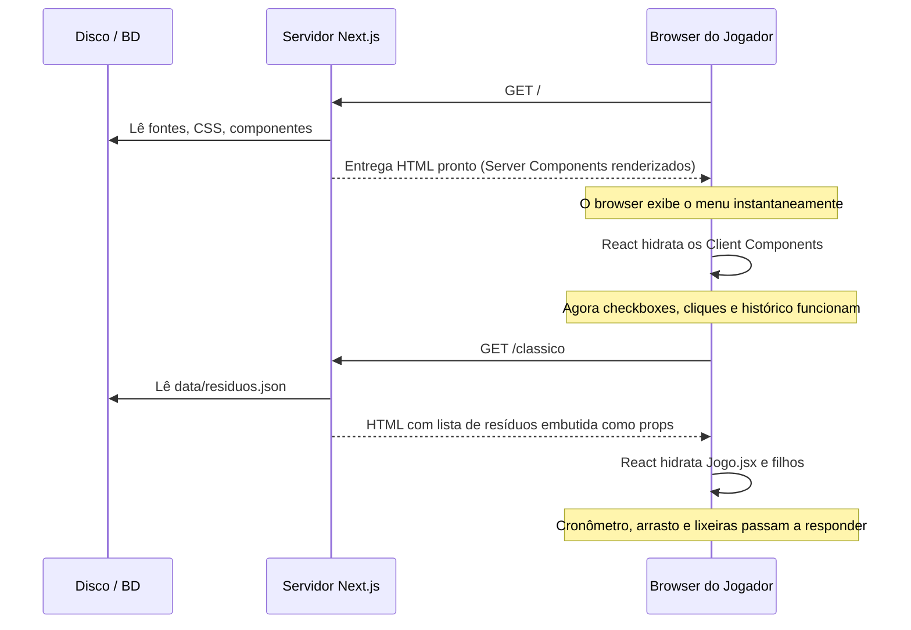
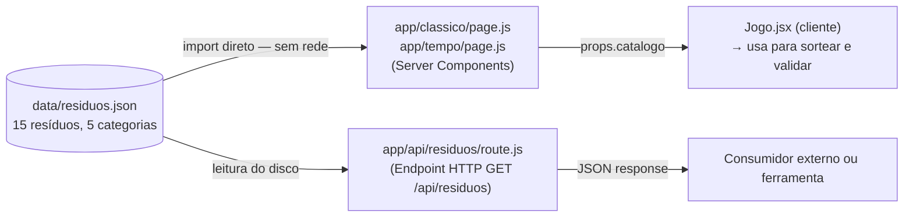
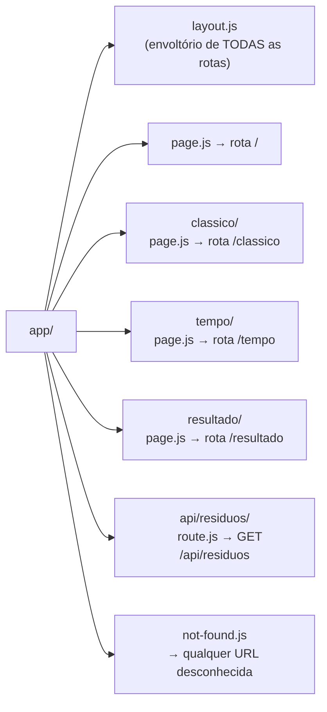
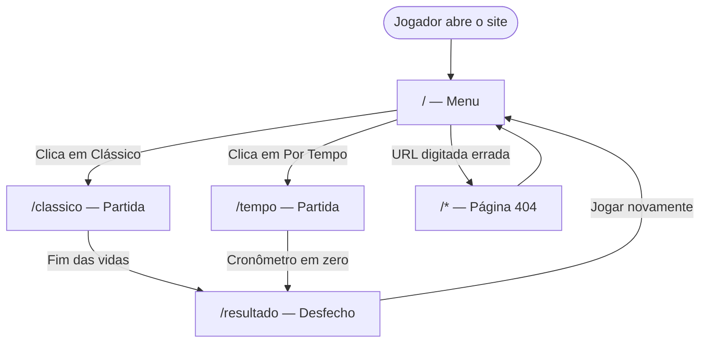

# Eco Mania — Especificação Técnica

Aplicação web educativa sobre separação de resíduos sólidos, construída em
Next.js com App Router.

---

## 1. Visão do produto

O Eco Mania ensina a destinar corretamente resíduos domésticos às cinco
categorias da **Resolução CONAMA 275/2001**, por meio de rodadas curtas de
decisão com retorno imediato.

A premissa pedagógica é que a informação adere melhor no instante da dúvida. O
jogador não recebe uma lista de regras antes de começar: ele decide, erra, e a
explicação daquele resíduo específico aparece no momento em que o erro
acontece. A pontuação sustenta o engajamento; a explicação é o produto.

O público-alvo são escolas, campanhas de educação ambiental e treinamentos
corporativos. A aplicação roda no navegador, sem instalação e sem cadastro.

---

## 2. Escopo

### 2.1 Dentro do escopo

- Dois modos de jogo com regras distintas
- Catálogo de resíduos com explicação individual por item
- Interação por clique e por arrasto, em dispositivos apontadores e de toque
- Registro local de recordes e das duas últimas partidas
- Modo de acessibilidade visual para daltonismo
- Interface responsiva de 320 pixels a telas amplas
- Endpoint HTTP para consulta ao catálogo

### 2.2 Fora do escopo

- Contas de usuário e autenticação
- Placar compartilhado entre jogadores
- Banco de dados ou persistência em servidor
- Painel administrativo para edição do catálogo
- Aplicativo nativo para celular
- Internacionalização

---

## 3. Requisitos funcionais

| ID | Requisito |
|---|---|
| RF01 | O sistema apresenta um menu com acesso aos dois modos de jogo |
| RF02 | O sistema sorteia um resíduo por rodada, sem repetir o da rodada anterior |
| RF03 | O jogador destina o resíduo a uma lixeira por clique ou por arrasto |
| RF04 | O sistema valida a destinação contra a categoria correta do resíduo |
| RF05 | Em caso de acerto, o sistema soma pontos e informa a categoria correta |
| RF06 | Em caso de erro, o sistema exibe a explicação específica daquele resíduo |
| RF07 | O sistema bloqueia novas jogadas enquanto o retorno está em exibição |
| RF08 | No modo clássico, o sistema debita uma vida a cada erro |
| RF09 | No modo clássico, a partida encerra quando as vidas chegam a zero |
| RF10 | No modo por tempo, o sistema conta sessenta segundos regressivamente |
| RF11 | No modo por tempo, a partida encerra quando o cronômetro chega a zero |
| RF12 | Ao encerrar, o sistema apresenta pontuação, estatísticas e recorde |
| RF13 | O sistema indica a categoria com maior número de erros na partida |
| RF14 | O sistema registra o recorde de cada modo separadamente |
| RF15 | O sistema mantém o registro das duas últimas partidas |
| RF16 | O sistema permite ativar a exibição do nome em cada lixeira |
| RF17 | A preferência de acessibilidade persiste entre sessões |
| RF18 | O sistema disponibiliza o catálogo de resíduos por endpoint HTTP |

---

## 4. Requisitos não funcionais

| ID | Categoria | Requisito |
|---|---|---|
| RNF01 | Acessibilidade | Nenhuma informação é transmitida exclusivamente por cor |
| RNF02 | Acessibilidade | Toda ação é alcançável por teclado, com foco visível |
| RNF03 | Acessibilidade | Mudanças de estado são anunciadas a leitores de tela |
| RNF04 | Acessibilidade | O texto alternativo das imagens não revela a resposta |
| RNF05 | Compatibilidade | Operação de 320 pixels de largura em diante, retrato e paisagem |
| RNF06 | Compatibilidade | Suporte a apontadores de mouse, toque e caneta |
| RNF07 | Usabilidade | Movimento reduzido quando o sistema operacional assim indica |
| RNF08 | Desempenho | Ausência de travamento perceptível durante o arrasto |
| RNF09 | Resiliência | Falha de armazenamento não interrompe a partida |
| RNF10 | Portabilidade | Operação sem conexão após o carregamento inicial |
| RNF11 | Manutenibilidade | Catálogo editável sem alteração de código |

---

## 5. Regras de negócio

### 5.1 Categorias

As cinco categorias seguem as cores da Resolução CONAMA 275/2001.

| Categoria | Cor oficial | Itens no catálogo |
|---|---|---|
| Vidro | verde | 3 |
| Plástico | vermelho | 3 |
| Papel | azul | 3 |
| Orgânico | marrom | 3 |
| Metal | amarelo | 3 |

As cores são conteúdo didático, não decisão estética. Nenhum modo de exibição
pode alterá-las: quem aprende na aplicação precisa reconhecer as mesmas cores
na rua.

### 5.2 Pontuação

| Situação | Pontos |
|---|---|
| Acerto | 10 |
| Acerto a partir do terceiro consecutivo | 15 |
| Erro | 0 |

A sequência de acertos zera a cada erro. A maior sequência alcançada é
registrada no resultado da partida. Erros não subtraem pontos — a penalidade é
a vida perdida, no modo clássico, ou o tempo consumido, no modo por tempo.

### 5.3 Modo clássico

| Parâmetro | Valor |
|---|---|
| Vidas iniciais | 3 |
| Condição de término | vidas em zero |
| Pausa após acerto | 1,2 segundo |
| Pausa após erro | 3 segundos |

A pausa após o erro é mais longa porque há texto explicativo a ser lido.

### 5.4 Modo por tempo

| Parâmetro | Valor |
|---|---|
| Tempo inicial | 60 segundos |
| Condição de término | cronômetro em zero |
| Pausa após acerto | 0,6 segundo |
| Pausa após erro | 1,6 segundo |

As pausas são mais curtas porque o cronômetro não interrompe durante a
exibição do retorno. Erros não eliminam o jogador; custam apenas o tempo
consumido pela leitura.

### 5.5 Recordes e histórico

Cada modo mantém um recorde independente: pontuações obtidas em sessenta
segundos não são comparáveis a pontuações obtidas com três vidas.

O histórico guarda exatamente duas partidas, em fila. A cada encerramento, a
partida mais recente ocupa a primeira posição, a anterior desce para a segunda
e a mais antiga é descartada.

---

## 6. Arquitetura

### 6.1 Tecnologias

| Camada | Escolha |
|---|---|
| Framework | Next.js com App Router |
| Linguagem | JavaScript |
| Interface | React |
| Estilos | CSS global com variáveis |
| Dados | arquivo JSON versionado |
| Persistência | armazenamento do navegador |

### 6.2 Princípios de projeto

**Estado como fonte única.** Nenhum componente manipula o documento
diretamente. A interface é função do estado, e alterações de estado provocam
a atualização da tela.

**Regra de validação centralizada.** Clique e arrasto são formas de entrada
distintas que convergem para a mesma rotina de validação. A regra do jogo
existe em um único ponto, o que impede divergência entre os dois caminhos.

**Separação entre dados e lógica.** O catálogo de resíduos é um arquivo de
dados versionado, sem instruções. Acrescentar um item não exige alteração de
código.

**Acessibilidade por padrão.** Os recursos de acessibilidade não são um modo
alternativo: a aplicação é operável por teclado e compreensível sem percepção
de cor em sua configuração inicial. O modo de acessibilidade visual adiciona
um reforço, nunca repara uma ausência.

### 6.3 Fronteira servidor e cliente

A aplicação renderiza no servidor por padrão. Componentes que dependem de
interação, temporizadores ou armazenamento do navegador são marcados como
componentes de cliente.

A marcação se propaga pela árvore: tudo renderizado dentro de um componente de
cliente também executa no cliente. A fronteira é desenhada no nível mais alto
possível de cada rota, de modo que a estrutura estática permaneça no servidor.

---

## 7. Estrutura de diretórios

```
eco-mania/
├── app/
│   ├── layout.js
│   ├── page.js
│   ├── not-found.js
│   ├── classico/page.js
│   ├── tempo/page.js
│   ├── resultado/page.js
│   └── api/residuos/route.js
│
├── components/
│   ├── Jogo.jsx
│   ├── Hud.jsx
│   ├── Residuo.jsx
│   ├── Lixeiras.jsx
│   ├── Lixeira.jsx
│   ├── Feedback.jsx
│   ├── BotaoModo.jsx
│   ├── CaixaDaltonico.jsx
│   ├── HistoricoPartidas.jsx
│   ├── PainelResultado.jsx
│   └── DicaRevisao.jsx
│
├── hooks/
│   ├── useJogo.js
│   ├── useCronometro.js
│   ├── useArraste.js
│   ├── useArmazenamento.js
│   └── useDaltonismo.js
│
├── lib/
│   ├── constantes.js
│   └── historico.js
│
├── data/
│   └── residuos.json
│
├── public/assets/
│   ├── cenario.png
│   ├── lixeiras/
│   ├── residuos/
│   └── svg/
│
└── styles/
    └── globals.css
```

---

## 8. Rotas

| Rota | Arquivo | Camada | Responsabilidade |
|---|---|---|---|
| — | `app/layout.js` | Servidor | Estrutura do documento, idioma, metadados e importação dos estilos |
| `/` | `app/page.js` | Servidor | Menu com apresentação, acesso aos modos, histórico e acessibilidade |
| `/classico` | `app/classico/page.js` | Servidor | Carrega o catálogo e monta a partida no modo clássico |
| `/tempo` | `app/tempo/page.js` | Servidor | Carrega o catálogo e monta a partida no modo por tempo |
| `/resultado` | `app/resultado/page.js` | Cliente | Recupera o resultado da partida e apresenta o desfecho |
| `/api/residuos` | `app/api/residuos/route.js` | Servidor | Entrega o catálogo em JSON, com filtro opcional por categoria |
| qualquer outra | `app/not-found.js` | Servidor | Página de endereço inexistente, com retorno ao menu |

As rotas de jogo são renderizadas no servidor e entregam o catálogo como
propriedade ao componente de partida, que opera no cliente. A rota de resultado
é de cliente por depender do armazenamento de sessão.

---

## 9. Componentes

| Componente | Camada | Responsabilidade | Entradas | Estado próprio |
|---|---|---|---|---|
| `Jogo` | Cliente | Conecta o estado da partida aos componentes visuais e coordena o fluxo de rodadas | modo de jogo, catálogo | nenhum |
| `Hud` | Cliente | Painel superior com pontuação e o marcador correspondente ao modo | modo, pontuação, vidas, tempo formatado | nenhum |
| `Residuo` | Cliente | Exibe o resíduo da rodada e responde ao arrasto por ponteiro | resíduo, permissão de jogada, ação de solte | deslocamento durante o arrasto |
| `Lixeiras` | Cliente | Dispõe as cinco lixeiras e encaminha a escolha do jogador | lixeira sob o ponteiro, ação de escolha | nenhum |
| `Lixeira` | Cliente | Lixeira individual com cor, símbolo e rótulo | categoria, rótulo, destaque, ação de escolha | nenhum |
| `Feedback` | Cliente | Faixa de retorno para acerto, erro e carregamento, anunciada a leitores de tela | mensagem, natureza da mensagem | nenhum |
| `BotaoModo` | Servidor | Cartão de acesso a um modo, com descrição e faixa de cor | destino, título, descrição, cor | nenhum |
| `CaixaDaltonico` | Cliente | Alterna a exibição dos rótulos e persiste a escolha | nenhuma | preferência ativa |
| `HistoricoPartidas` | Cliente | Lista as duas últimas partidas, ocultando-se quando não há registro | nenhuma | registros recuperados |
| `PainelResultado` | Cliente | Blocos de estatística correspondentes ao modo jogado | resultado da partida | nenhum |
| `DicaRevisao` | Cliente | Frase de revisão com exemplos da categoria de maior erro | categoria, catálogo | nenhum |

---

## 10. Hooks

| Hook | Responsabilidade | Entrega |
|---|---|---|
| `useJogo` | Estado e regras da partida: sorteio, validação, pontuação, vidas, sequência e encerramento | estado da partida e a ação de responder |
| `useCronometro` | Contagem regressiva, formatação e sinalização de término | segundos restantes e tempo formatado |
| `useArraste` | Arrasto por eventos de ponteiro, identificação do alvo e destaque da lixeira | deslocamento, alvo atual e manipuladores de evento |
| `useArmazenamento` | Leitura e escrita no armazenamento do navegador, com proteção contra execução no servidor e contra bloqueio | valor atual e ação de gravação |
| `useDaltonismo` | Recupera e aplica a preferência de exibição de rótulos | estado da preferência e ação de alternância |

---

## 11. Módulos de domínio

| Módulo | Conteúdo |
|---|---|
| `lib/constantes.js` | Rótulos das categorias, chaves de armazenamento, durações de pausa e valores de pontuação |
| `lib/historico.js` | Formatação do registro de partida e rotação da fila de duas posições |

Concentrar durações, chaves e valores de pontuação em um módulo único evita a
dispersão desses números pelo código, situação em que alterar um e esquecer
outro é o modo de falha mais comum.

---

## 12. Modelo de dados

O catálogo reside em `data/residuos.json`. Cada resíduo é descrito por quatro
atributos.

| Atributo | Tipo | Descrição |
|---|---|---|
| `arquivo` | texto | Nome do arquivo de imagem em `public/assets/residuos/` |
| `nome` | texto | Designação do objeto, exibida ao jogador e usada como texto alternativo |
| `categoria` | texto | Uma das cinco categorias; corresponde ao identificador da lixeira |
| `explicacao` | texto | Justificativa da destinação correta, exibida em caso de erro |

O array fica encapsulado em um objeto raiz, o que permite acrescentar
metadados — versão, data de atualização, lista de categorias — sem romper
contrato com consumidores existentes.

### Regra de conteúdo

O atributo `nome` designa o **objeto**, nunca a categoria. "Garrafa de
refrigerante", e não "garrafa de plástico".

A regra não é estilística. O mesmo valor serve de texto alternativo da imagem:
se contivesse a categoria, o leitor de tela anunciaria a resposta e a
aplicação deixaria de ser um jogo para quem depende dele. A restrição atende
diretamente o RNF04.

---

## 13. Estado e persistência

### 13.1 Estado em memória

| Dado | Responsável | Duração |
|---|---|---|
| Pontuação, vidas, acertos, erros, sequência | `useJogo` | a partida |
| Resíduo atual e anterior | `useJogo` | a partida |
| Permissão de jogada | `useJogo` | a partida |
| Segundos restantes | `useCronometro` | a partida |
| Deslocamento do arrasto | `useArraste` | o arrasto |

### 13.2 Armazenamento de sessão

Encerrado ao fechar a aba. Transporta o resultado da partida até a rota de
resultado.

| Conteúdo |
|---|
| Modo jogado |
| Pontuação final |
| Vidas restantes |
| Total de acertos e de erros |
| Maior sequência de acertos |
| Recorde do modo e indicação de superação |
| Categoria com maior número de erros |

### 13.3 Armazenamento persistente

Mantido entre sessões.

| Conteúdo |
|---|
| Preferência de exibição de rótulos |
| Recorde do modo clássico |
| Recorde do modo por tempo |
| Registro da última partida |
| Registro da penúltima partida |

### 13.4 Tolerância a falha

Navegadores bloqueiam o armazenamento em contextos de origem local e em
sessões anônimas. Todo acesso é intermediado pelo `useArmazenamento`, que trata
a indisponibilidade e devolve valores padrão. Uma gravação malsucedida não
interrompe a partida em andamento, conforme o RNF09.

---

## 14. Interface de dados

### 14.1 Endpoint

| Método | Caminho | Parâmetro | Resposta |
|---|---|---|---|
| GET | `/api/residuos` | — | catálogo completo |
| GET | `/api/residuos` | `categoria` | resíduos da categoria indicada |
| GET | `/api/residuos` | categoria inexistente | erro com código 404 |

### 14.2 Consumo interno

As rotas de jogo obtêm o catálogo diretamente na renderização de servidor, sem
requisição de rede. Essa escolha elimina estado de carregamento e tratamento
de erro nas telas de partida, e entrega os dados junto com o documento.

O endpoint atende o RF18 e existe para consumo externo, filtragem no servidor e
eventual substituição da fonte de dados sem alteração nos consumidores.

---

## 15. Acessibilidade

A paleta da CONAMA cria uma dificuldade concreta: para deuteranopia e
protanopia, os dois tipos mais frequentes de daltonismo, verde, vermelho,
marrom e amarelo são percebidos de forma semelhante. Quatro das cinco lixeiras
seriam indistinguíveis.

A aplicação responde com três sinais independentes de identificação.

| Sinal | Disponibilidade | Função |
|---|---|---|
| Cor da categoria | permanente | conteúdo didático da aplicação |
| Símbolo gráfico | permanente | diferenciação por forma |
| Rótulo textual | opcional | reforço explícito |

As cores permanecem inalteradas em qualquer configuração. Substituí-las por
uma paleta de maior contraste tornaria o aprendizado inútil fora da aplicação.
O rótulo acrescenta um sinal; não substitui nenhum.

A configuração inicial já é operável sem percepção de cor, atendendo o critério
**1.4.1 (Use of Color)** da WCAG 2.1. O rótulo é conveniência adicional, não
condição de uso.

Demais medidas:

| Medida | Requisito atendido |
|---|---|
| Lixeiras implementadas como botões, alcançáveis por tabulação | RNF02 |
| Indicador de foco visível, exibido apenas na navegação por teclado | RNF02 |
| Região de anúncio para leitores de tela na faixa de retorno | RNF03 |
| Texto alternativo que designa o objeto sem revelar a categoria | RNF04 |
| Supressão de transições conforme preferência do sistema operacional | RNF07 |

---

## 16. Responsividade

A estratégia privilegia dimensionamento contínuo sobre pontos de ruptura.
Tamanhos de imagem e de tipografia variam de forma proporcional entre um
mínimo e um máximo, o que elimina o salto visual característico de layouts
construídos apenas com consultas de mídia.

As consultas de mídia tratam o que o dimensionamento contínuo não resolve:
espaçamento, empilhamento e reorganização.

| Faixa | Ajustes |
|---|---|
| Tablet | redução de espaçamento |
| Celular | redução tipográfica, liberação do fundo fixo |
| Celular estreito | reorganização do painel, quebra das lixeiras em duas linhas |
| Orientação paisagem | compactação vertical |

A faixa de paisagem é condicionada à **altura** disponível, não à largura. Em
orientação horizontal o constrangimento é vertical: sem a compactação, as
lixeiras ficam fora da área visível e a aplicação se torna inoperável,
violando o RNF05.

### Entrada por ponteiro

A entrada por arrasto utiliza eventos de ponteiro, que unificam mouse, toque e
caneta em um único conjunto de manipuladores, atendendo o RNF06.

Duas condições são obrigatórias para operação em telas de toque:

**Supressão da ação padrão de toque sobre o resíduo.** Sem ela, o navegador
interpreta o arrasto como solicitação de rolagem.

**Deslocamento por transformação visual.** O elemento arrastado permanece no
fluxo do documento. Removê-lo do fluxo provoca reposicionamento das lixeiras
durante o arrasto, e o alvo deixa de corresponder à posição percebida pelo
jogador.

---

## 17. Riscos técnicos

| Risco | Impacto | Mitigação |
|---|---|---|
| Acesso ao armazenamento durante a renderização de servidor | Interrupção da construção do projeto | Acesso restrito ao `useArmazenamento`, posterior à montagem |
| Divergência entre renderização de servidor e de cliente | Advertências e alteração visual após a carga | Sorteio e leitura de data posteriores à montagem |
| Temporizador sem rotina de encerramento | Contagens simultâneas e consumo acelerado do tempo | Encerramento vinculado ao ciclo de vida do efeito |
| Captura de valor desatualizado na contagem regressiva | Cronômetro estacionado | Atualização por função sobre o valor anterior |
| Atualização excessiva durante o arrasto | Travamento perceptível em dispositivos móveis | Dados do arrasto mantidos em referência, fora do estado |
| Ausência da supressão de ação de toque | Arrasto inoperante em telas de toque | Item obrigatório de verificação na fase correspondente |
| Caminhos de recurso incorretos | Imagens ausentes em todas as telas | Verificação integral na primeira fase |

---

## 18. Fases de implementação

Cada fase resulta em um produto operacional. Nenhuma depende da seguinte para
ter valor demonstrável.

| Fase | Escopo | Resultado |
|---|---|---|
| 1 | Estrutura do projeto, recursos estáticos, estilos globais e as cinco rotas com marcação | Telas navegáveis, sem interação |
| 2 | Catálogo, tipos, constantes e endpoint | Dados disponíveis às rotas |
| 3 | Modo clássico por clique: estado da partida, painel, lixeiras e retorno | Jogo completo, operável em todos os dispositivos |
| 4 | Modo por tempo e cronômetro | Ambos os modos operacionais |
| 5 | Resultado, histórico e dica de revisão | Ciclo completo de partida |
| 6 | Arrasto por ponteiro | Conjunto completo de formas de entrada |

A entrada por arrasto é deliberadamente a última fase. É o componente de maior
complexidade e menor criticidade: a partir da Fase 3 a entrada por clique já
atende todos os dispositivos, incluindo telas de toque.

---

## 19. Critérios de aceite

### 19.1 Funcionais

| Critério | Requisitos |
|---|---|
| O menu dá acesso aos dois modos de jogo | RF01 |
| Ambos os modos iniciam, pontuam e encerram pela condição prevista | RF09, RF11 |
| O sorteio nunca repete o resíduo da rodada imediatamente anterior | RF02 |
| A destinação é validada contra a categoria correta do resíduo | RF04 |
| No modo clássico, cada erro debita exatamente uma vida | RF08 |
| No modo por tempo, a contagem parte de sessenta segundos e é regressiva | RF10 |
| O bônus de sequência é aplicado a partir do terceiro acerto consecutivo | RF05 |
| A explicação exibida corresponde ao resíduo respondido | RF06 |
| Novas jogadas são bloqueadas durante a exibição do retorno | RF07 |
| Recorde, histórico e preferência persistem entre sessões | RF14, RF15, RF17 |
| O histórico mantém exatamente dois registros | RF15 |
| O resultado apresenta pontuação, estatísticas e recorde do modo | RF12 |
| O resultado indica a categoria com maior número de erros da partida | RF13 |
| A ativação do modo de acessibilidade exibe o rótulo em cada lixeira | RF16 |
| O acesso à rota de resultado sem partida registrada redireciona ao menu | — |
| O endpoint responde ao catálogo completo e ao filtro por categoria | RF18 |

### 19.2 Interação

| Critério | Requisitos |
|---|---|
| A destinação é possível por clique e por arrasto | RF03 |
| Clique operante em apontadores e em telas de toque | RNF06 |
| Arrasto operante em apontadores e em telas de toque | RNF06 |
| Ausência de travamento perceptível durante o arrasto em dispositivo móvel | RNF08 |
| Lixeira sob o ponteiro destacada durante o arrasto | — |
| Ausência de rolagem involuntária durante o arrasto em telas de toque | RNF06 |
| Operação integral por teclado, com foco visível | RNF02 |

### 19.3 Compatibilidade

| Critério | Requisitos |
|---|---|
| Ausência de rolagem horizontal em 320, 390, 740, 768 e 1440 pixels | RNF05 |
| Cinco lixeiras visíveis nessas resoluções, em retrato e em paisagem | RNF05 |
| Ausência de erros e de advertências de hidratação em todas as rotas | — |
| Operação após desconexão da rede, concluída a carga inicial | RNF10 |
| Falha de gravação no armazenamento não interrompe a partida | RNF09 |
| Acréscimo de resíduo ao catálogo não exige alteração de código | RNF11 |

### 19.4 Acessibilidade

| Critério | Requisitos |
|---|---|
| Categorias distinguíveis sem percepção de cor, na configuração inicial | RNF01 |
| Texto alternativo sem menção à categoria do resíduo | RNF04 |
| Mudanças de retorno anunciadas a leitores de tela | RNF03 |
| Transições suprimidas sob preferência de movimento reduzido | RNF07 |

---

## 20. Glossário

| Termo | Significado |
|---|---|
| **Catálogo** | Conjunto de resíduos disponíveis para sorteio |
| **Categoria** | Uma das cinco destinações da Resolução CONAMA 275/2001 |
| **Rodada** | Ciclo de sorteio, decisão e retorno |
| **Partida** | Sequência de rodadas até a condição de término |
| **Sequência** | Número de acertos consecutivos sem erro intermediário |
| **Retorno** | Mensagem de acerto ou erro exibida após a decisão |
| **Componente de cliente** | Componente que executa no navegador, por depender de interação, temporizador ou armazenamento |
| **Hidratação** | Momento em que o React assume o controle da marcação entregue pelo servidor |


---

## 21. Servidor vs. Cliente no Next.js App Router

No Next.js moderno (App Router), **todo componente é Server Component por padrão** — a menos que declare `"use client"` na primeira linha. Isso importa porque define **onde o JavaScript executa** e **o que pode ser feito**.

| Ambiente | Tem acesso a... | Não tem acesso a... |
|---|---|---|
| **Servidor** | Sistema de arquivos, variáveis de ambiente, banco de dados | `window`, `localStorage`, `useState`, eventos do browser |
| **Cliente** | `window`, `localStorage`, `useState`, eventos de clique, temporizadores | Sistema de arquivos, env secrets |

> [!IMPORTANT]
> A marcação `"use client"` se **propaga pela árvore**: qualquer componente filho de um Client Component também executa no cliente, mesmo sem declarar `"use client"` explicitamente.

---

## 22. Quais componentes rodam onde

### Componentes de Servidor (Server Components)

Executam apenas no servidor. São renderizados para HTML estático antes de chegar ao browser.

| Arquivo | Por quê é Servidor? |
|---|---|
| `app/layout.js` | Sem interação; só estrutura HTML, importação de fontes e CSS |
| `app/page.js` | Sem estado ou eventos; é apenas o menu estático |
| `app/classico/page.js` | Lê `residuos.json` do disco e passa como `props` para `Jogo` |
| `app/tempo/page.js` | Idem acima |
| `app/not-found.js` | Página 404 estática |
| `BotaoModo.jsx` | Sem estado; é um link `<a>` estilizado. Nenhuma interação dinâmica |
| `Feedback.jsx` | Recebe `props` e renderiza texto. Sem eventos ou estado |
| `Hud.jsx` | Recebe `props` e renderiza texto. Sem eventos ou estado |
| `PainelResultado.jsx` | Recebe `props` e renderiza estatísticas. Sem eventos |
| `DicaRevisao.jsx` | Recebe `props` e renderiza texto educativo. Sem eventos |
| `Lixeiras.jsx` | Renderiza os botões filhos, mas não captura eventos diretamente |
| `Lixeira.jsx` | Tem `onClick`, mas só funciona porque é filho de um Client Component |

> [!NOTE]
> `Lixeiras.jsx` e `Lixeira.jsx` não têm `"use client"`, mas ao serem renderizados dentro de `Jogo.jsx` (que é Client Component), **entram automaticamente no ambiente de cliente** pela propagação da árvore.

### Componentes de Cliente (Client Components)

Precisam de `"use client"` porque dependem de estado, eventos do browser ou APIs do navegador.

| Arquivo | Por quê precisa ser Cliente? |
|---|---|
| `Jogo.jsx` | `useState`, `useEffect`, `setInterval`, `document.elementFromPoint` |
| `Residuo.jsx` | `useState` (deslocamento do arrasto), `useRef`, eventos de ponteiro |
| `PartidaCliente.jsx` | `useRouter` para redirecionar, `sessionStorage` e `localStorage` para gravar resultado |
| `CaixaDaltonico.jsx` | `useState`, `localStorage` para ler/gravar preferência |
| `HistoricoPartidas.jsx` | `useState`, `localStorage` para ler histórico de partidas |
| `app/resultado/page.js` | `sessionStorage` para recuperar o resultado da partida encerrada |

### Diagrama de componentes

<svg xmlns="http://www.w3.org/2000/svg" viewBox="0 0 1404.8284166666667 1445.6" width="1404.8284166666667" height="1445.6" style="--bg:#1F1F1F;--fg:#CCCCCC;--line:#CCCCCC;--accent:#0078D4;--muted:#CCCCCCCC;--surface:#181818;--border:#CCCCCC;background:var(--bg)">
<style>
  @import url('https://fonts.googleapis.com/css2?family=Inter:wght@400;500;600;700&amp;display=swap');
  text { font-family: 'Inter', system-ui, sans-serif; }
  svg {
    --_text:          var(--fg);
    --_text-sec:      var(--muted, color-mix(in srgb, var(--fg) 60%, var(--bg)));
    --_text-muted:    var(--muted, color-mix(in srgb, var(--fg) 40%, var(--bg)));
    --_text-faint:    color-mix(in srgb, var(--fg) 25%, var(--bg));
    --_line:          var(--line, color-mix(in srgb, var(--fg) 50%, var(--bg)));
    --_arrow:         var(--accent, color-mix(in srgb, var(--fg) 85%, var(--bg)));
    --_node-fill:     var(--surface, color-mix(in srgb, var(--fg) 3%, var(--bg)));
    --_node-stroke:   var(--border, color-mix(in srgb, var(--fg) 20%, var(--bg)));
    --_group-fill:    var(--bg);
    --_group-hdr:     color-mix(in srgb, var(--fg) 5%, var(--bg));
    --_inner-stroke:  color-mix(in srgb, var(--fg) 12%, var(--bg));
    --_key-badge:     color-mix(in srgb, var(--fg) 10%, var(--bg));
  }
</style>
<defs>
  <marker id="arrowhead" markerWidth="8" markerHeight="5" refX="7" refY="2.5" orient="auto">
    <polygon points="0 0, 8 2.5, 0 5" fill="var(--_arrow)" stroke="var(--_arrow)" stroke-width="0.75" stroke-linejoin="round" />
  </marker>
  <marker id="arrowhead-start" markerWidth="8" markerHeight="5" refX="1" refY="2.5" orient="auto-start-reverse">
    <polygon points="8 0, 0 2.5, 8 5" fill="var(--_arrow)" stroke="var(--_arrow)" stroke-width="0.75" stroke-linejoin="round" />
  </marker>
</defs>
<g class="subgraph" data-id="Inicializacao" data-label="1. Ponto de Entrada da Aplicação">
  <rect x="851.0214166666667" y="40" width="241.41599999999994" height="181.8" rx="0" ry="0" fill="var(--_group-fill)" stroke="var(--_node-stroke)" stroke-width="1" />
  <rect x="851.0214166666667" y="40" width="241.41599999999994" height="28" rx="0" ry="0" fill="var(--_group-hdr)" stroke="var(--_node-stroke)" stroke-width="1" />
  <text x="863.0214166666667" y="54" font-size="12" font-weight="600" fill="var(--_text-sec)" dy="4.199999999999999">1. Ponto de Entrada da Aplicação</text>
</g>
<g class="subgraph" data-id="Menu" data-label="2. Componentes da Tela Inicial">
  <rect x="548.2494166666668" y="281.8" width="816.579" height="96.9" rx="0" ry="0" fill="var(--_group-fill)" stroke="var(--_node-stroke)" stroke-width="1" />
  <rect x="548.2494166666668" y="281.8" width="816.579" height="28" rx="0" ry="0" fill="var(--_group-hdr)" stroke="var(--_node-stroke)" stroke-width="1" />
  <text x="560.2494166666668" y="295.8" font-size="12" font-weight="600" fill="var(--_text-sec)" dy="4.199999999999999">2. Componentes da Tela Inicial</text>
</g>
<g class="subgraph" data-id="RotasPartida" data-label="3. Rotas de Partida">
  <rect x="624.2019166666666" y="507" width="373.61" height="96.9" rx="0" ry="0" fill="var(--_group-fill)" stroke="var(--_node-stroke)" stroke-width="1" />
  <rect x="624.2019166666666" y="507" width="373.61" height="28" rx="0" ry="0" fill="var(--_group-hdr)" stroke="var(--_node-stroke)" stroke-width="1" />
  <text x="636.2019166666666" y="521" font-size="12" font-weight="600" fill="var(--_text-sec)" dy="4.199999999999999">3. Rotas de Partida</text>
</g>
<g class="subgraph" data-id="Orquestrador" data-label="4. Componente Coordenador da Partida">
  <rect x="627.6096666666667" y="663.9" width="224.81400000000002" height="264.1" rx="0" ry="0" fill="var(--_group-fill)" stroke="var(--_node-stroke)" stroke-width="1" />
  <rect x="627.6096666666667" y="663.9" width="224.81400000000002" height="28" rx="0" ry="0" fill="var(--_group-hdr)" stroke="var(--_node-stroke)" stroke-width="1" />
  <text x="639.6096666666667" y="677.9" font-size="12" font-weight="600" fill="var(--_text-sec)" dy="4.199999999999999">4. Componente Coordenador da Partida</text>
</g>
<g class="subgraph" data-id="FilhosJogo" data-label="5. Subcomponentes do Jogo">
  <rect x="40" y="988" width="1029.9125" height="181.8" rx="0" ry="0" fill="var(--_group-fill)" stroke="var(--_node-stroke)" stroke-width="1" />
  <rect x="40" y="988" width="1029.9125" height="28" rx="0" ry="0" fill="var(--_group-hdr)" stroke="var(--_node-stroke)" stroke-width="1" />
  <text x="52" y="1002" font-size="12" font-weight="600" fill="var(--_text-sec)" dy="4.199999999999999">5. Subcomponentes do Jogo</text>
</g>
<g class="subgraph" data-id="Desfecho" data-label="6. Tela de Resultado">
  <rect x="951.5715" y="1223.8" width="357.308" height="181.8" rx="0" ry="0" fill="var(--_group-fill)" stroke="var(--_node-stroke)" stroke-width="1" />
  <rect x="951.5715" y="1223.8" width="357.308" height="28" rx="0" ry="0" fill="var(--_group-hdr)" stroke="var(--_node-stroke)" stroke-width="1" />
  <text x="963.5715" y="1237.8" font-size="12" font-weight="600" fill="var(--_text-sec)" dy="4.199999999999999">6. Tela de Resultado</text>
</g>
<polyline class="edge" data-from="Page" data-to="BotaoModoClassico" points="971.7294166666667,205.8 971.7294166666667,265.8 667.4754166666668,265.8 667.4754166666668,325.8" fill="none" stroke="var(--_line)" stroke-width="1" marker-end="url(#arrowhead)" />
<polyline class="edge" data-from="Page" data-to="BotaoModoTempo" points="971.7294166666667,205.8 971.7294166666667,265.8 907.4849166666667,265.8 907.4849166666667,325.8" fill="none" stroke="var(--_line)" stroke-width="1" marker-end="url(#arrowhead)" />
<polyline class="edge" data-from="Page" data-to="CaixaDaltonico" points="971.7294166666667,205.8 971.7294166666667,265.8 1109.7034166666667,265.8 1109.7034166666667,325.8" fill="none" stroke="var(--_line)" stroke-width="1" marker-end="url(#arrowhead)" />
<polyline class="edge" data-from="Page" data-to="HistoricoPartidas" points="971.7294166666667,205.8 971.7294166666667,265.8 1275.9834166666667,265.8 1275.9834166666667,325.8" fill="none" stroke="var(--_line)" stroke-width="1" marker-end="url(#arrowhead)" />
<polyline class="edge" data-from="BotaoModoClassico" data-to="RotaClassico" data-label="Navega /classico" points="667.4754166666668,362.70000000000005 667.4754166666668,420.70000000000005 695.0776666666668,420.70000000000005 695.0776666666668,489.00000000000006 722.6799166666667,489.00000000000006 722.6799166666667,551" fill="none" stroke="var(--_line)" stroke-width="1" stroke-dasharray="4 4" marker-end="url(#arrowhead)" />
<polyline class="edge" data-from="BotaoModoTempo" data-to="RotaTempo" data-label="Navega /tempo" points="907.4849166666667,362.70000000000005 907.4849166666668,551" fill="none" stroke="var(--_line)" stroke-width="1" stroke-dasharray="4 4" marker-end="url(#arrowhead)" />
<polyline class="edge" data-from="RotaClassico" data-to="Jogo" points="722.6799166666667,587.9 722.6799166666667,645.9 805.9686666666668,645.9 805.9686666666669,839.0999999999999 789.5136666666668,839.0999999999999 789.5136666666668,875.0999999999999" fill="none" stroke="var(--_line)" stroke-width="1" marker-end="url(#arrowhead)" />
<polyline class="edge" data-from="RotaTempo" data-to="Jogo" points="907.4849166666667,587.9 907.4849166666667,645.9 824.1961666666667,645.9 824.1961666666668,839.0999999999999 812.9686666666669,839.0999999999999 812.9686666666669,875.0999999999999" fill="none" stroke="var(--_line)" stroke-width="1" marker-end="url(#arrowhead)" />
<polyline class="edge" data-from="Jogo" data-to="Hud" points="805.1503333333335,912 805.1503333333334,970 944.3879999999999,970 944.3879999999999,1032" fill="none" stroke="var(--_line)" stroke-width="1" marker-end="url(#arrowhead)" />
<polyline class="edge" data-from="Jogo" data-to="Residuo" points="758.2403333333334,912 758.2403333333334,946 233.25150000000008,946 233.25149999999996,1032" fill="none" stroke="var(--_line)" stroke-width="1" marker-end="url(#arrowhead)" />
<polyline class="edge" data-from="Jogo" data-to="Feedback" points="789.5136666666667,912 789.5136666666667,970 665.1054999999999,970 665.1054999999999,1032" fill="none" stroke="var(--_line)" stroke-width="1" marker-end="url(#arrowhead)" />
<polyline class="edge" data-from="Jogo" data-to="Lixeiras" points="773.8770000000001,912 773.8770000000001,958 438.8045,958 438.80449999999996,1032" fill="none" stroke="var(--_line)" stroke-width="1" marker-end="url(#arrowhead)" />
<polyline class="edge" data-from="Jogo" data-to="RotaResultado" data-label="Fim da partida" points="820.7870000000001,912 820.787,958 1135.4125,958 1135.4125000000001,1267.8" fill="none" stroke="var(--_line)" stroke-width="1" stroke-dasharray="4 4" marker-end="url(#arrowhead)" />
<polyline class="edge" data-from="Layout" data-to="Page" points="971.7294166666667,120.9 971.7294166666667,168.9" fill="none" stroke="var(--_line)" stroke-width="1" marker-end="url(#arrowhead)" />
<polyline class="edge" data-from="Catalogo" data-to="Jogo" data-label="Fornece dados" points="719.7891666666667,758.8 719.7891666666667,839.0999999999999 766.0586666666668,839.0999999999999 766.0586666666668,875.0999999999999" fill="none" stroke="var(--_line)" stroke-width="1" stroke-dasharray="4 4" marker-end="url(#arrowhead)" />
<polyline class="edge" data-from="Lixeiras" data-to="Lixeira1" points="438.80449999999996,1068.9 438.80449999999996,1092.9 276.22950000000003,1092.9 276.22950000000003,1116.9" fill="none" stroke="var(--_line)" stroke-width="1" marker-end="url(#arrowhead)" />
<polyline class="edge" data-from="Lixeiras" data-to="Lixeira2" points="438.80449999999996,1068.9 438.80449999999996,1092.9 438.8045,1092.9 438.8045,1116.9" fill="none" stroke="var(--_line)" stroke-width="1" marker-end="url(#arrowhead)" />
<polyline class="edge" data-from="Lixeiras" data-to="Lixeira3" points="438.80449999999996,1068.9 438.80449999999996,1092.9 120.3235,1092.9 120.3235,1116.9" fill="none" stroke="var(--_line)" stroke-width="1" marker-end="url(#arrowhead)" />
<polyline class="edge" data-from="Lixeiras" data-to="Lixeira4" points="438.80449999999996,1068.9 438.80449999999996,1092.9 612.4945,1092.9 612.4945,1116.9" fill="none" stroke="var(--_line)" stroke-width="1" marker-end="url(#arrowhead)" />
<polyline class="edge" data-from="Lixeiras" data-to="Lixeira5" points="438.80449999999996,1068.9 438.80449999999996,1092.9 778.404,1092.9 778.404,1116.9" fill="none" stroke="var(--_line)" stroke-width="1" marker-end="url(#arrowhead)" />
<polyline class="edge" data-from="RotaResultado" data-to="PainelResultado" points="1135.4125000000001,1304.7 1135.4125000000001,1328.7 1047.0855,1328.7 1047.0855,1352.7" fill="none" stroke="var(--_line)" stroke-width="1" marker-end="url(#arrowhead)" />
<polyline class="edge" data-from="RotaResultado" data-to="DicaRevisao" points="1135.4125000000001,1304.7 1135.4125000000001,1328.7 1223.7395000000001,1328.7 1223.7395000000001,1352.7" fill="none" stroke="var(--_line)" stroke-width="1" marker-end="url(#arrowhead)" />
<g class="edge-label" data-from="BotaoModoClassico" data-to="RotaClassico" data-label="Navega /classico">
  <rect x="645.0776666666668" y="427.70000000000005" width="99.62200000000001" height="30.3" rx="2" ry="2" fill="var(--bg)" stroke="var(--_inner-stroke)" stroke-width="1" />
  <text x="694.8886666666668" y="442.85" text-anchor="middle" font-size="11" font-weight="400" fill="var(--_text-sec)" dy="3.8499999999999996">Navega /classico</text>
</g>
<g class="edge-label" data-from="BotaoModoTempo" data-to="RotaTempo" data-label="Navega /tempo">
  <rect x="863.9849166666665" y="427.70000000000005" width="86.554" height="30.3" rx="2" ry="2" fill="var(--bg)" stroke="var(--_inner-stroke)" stroke-width="1" />
  <text x="907.2619166666666" y="442.85" text-anchor="middle" font-size="11" font-weight="400" fill="var(--_text-sec)" dy="3.8499999999999996">Navega /tempo</text>
</g>
<g class="edge-label" data-from="Jogo" data-to="RotaResultado" data-label="Fim da partida">
  <rect x="1093.9125" y="1144.5" width="82.99000000000001" height="30.3" rx="2" ry="2" fill="var(--bg)" stroke="var(--_inner-stroke)" stroke-width="1" />
  <text x="1135.4074999999998" y="1159.65" text-anchor="middle" font-size="11" font-weight="400" fill="var(--_text-sec)" dy="3.8499999999999996">Fim da partida</text>
</g>
<g class="edge-label" data-from="Catalogo" data-to="Jogo" data-label="Fornece dados">
  <rect x="674.2891666666667" y="801.8000000000001" width="90.71200000000002" height="30.3" rx="2" ry="2" fill="var(--bg)" stroke="var(--_inner-stroke)" stroke-width="1" />
  <text x="719.6451666666667" y="816.95" text-anchor="middle" font-size="11" font-weight="400" fill="var(--_text-sec)" dy="3.8499999999999996">Fornece dados</text>
</g>
<g class="node" data-id="Layout" data-label="app/layout.js (RootLayout)" data-shape="rectangle">
  <rect x="874.4314166666667" y="84" width="194.59599999999998" height="36.900000000000006" rx="0" ry="0" fill="var(--_node-fill)" stroke="var(--_node-stroke)" stroke-width="0.75" />
  <text x="971.7294166666667" y="102.45" text-anchor="middle" font-size="13" font-weight="500" fill="var(--_text)" dy="4.55">app/layout.js (RootLayout)</text>
</g>
<g class="node" data-id="Page" data-label="app/page.js (Menu Principal)" data-shape="rectangle">
  <rect x="867.0214166666667" y="168.9" width="209.41599999999994" height="36.900000000000006" rx="0" ry="0" fill="var(--_node-fill)" stroke="var(--_node-stroke)" stroke-width="0.75" />
  <text x="971.7294166666667" y="187.35000000000002" text-anchor="middle" font-size="13" font-weight="500" fill="var(--_text)" dy="4.55">app/page.js (Menu Principal)</text>
</g>
<g class="node" data-id="BotaoModoClassico" data-label="BotaoModo (Modo Clássico)" data-shape="rectangle">
  <rect x="564.2494166666668" y="325.8" width="206.45199999999994" height="36.900000000000006" rx="0" ry="0" fill="var(--_node-fill)" stroke="var(--_node-stroke)" stroke-width="0.75" />
  <text x="667.4754166666668" y="344.25" text-anchor="middle" font-size="13" font-weight="500" fill="var(--_text)" dy="4.55">BotaoModo (Modo Clássico)</text>
</g>
<g class="node" data-id="BotaoModoTempo" data-label="BotaoModo (Modo por Tempo)" data-shape="rectangle">
  <rect x="798.7014166666667" y="325.8" width="217.56699999999998" height="36.900000000000006" rx="0" ry="0" fill="var(--_node-fill)" stroke="var(--_node-stroke)" stroke-width="0.75" />
  <text x="907.4849166666667" y="344.25" text-anchor="middle" font-size="13" font-weight="500" fill="var(--_text)" dy="4.55">BotaoModo (Modo por Tempo)</text>
</g>
<g class="node" data-id="CaixaDaltonico" data-label="CaixaDaltonico" data-shape="rectangle">
  <rect x="1044.2684166666668" y="325.8" width="130.87" height="36.900000000000006" rx="0" ry="0" fill="var(--_node-fill)" stroke="var(--_node-stroke)" stroke-width="0.75" />
  <text x="1109.7034166666667" y="344.25" text-anchor="middle" font-size="13" font-weight="500" fill="var(--_text)" dy="4.55">CaixaDaltonico</text>
</g>
<g class="node" data-id="HistoricoPartidas" data-label="HistoricoPartidas" data-shape="rectangle">
  <rect x="1203.1384166666667" y="325.8" width="145.69" height="36.900000000000006" rx="0" ry="0" fill="var(--_node-fill)" stroke="var(--_node-stroke)" stroke-width="0.75" />
  <text x="1275.9834166666667" y="344.25" text-anchor="middle" font-size="13" font-weight="500" fill="var(--_text)" dy="4.55">HistoricoPartidas</text>
</g>
<g class="node" data-id="RotaClassico" data-label="app/classico/page.js" data-shape="rectangle">
  <rect x="640.2019166666666" y="551" width="164.95600000000002" height="36.900000000000006" rx="0" ry="0" fill="var(--_node-fill)" stroke="var(--_node-stroke)" stroke-width="0.75" />
  <text x="722.6799166666667" y="569.45" text-anchor="middle" font-size="13" font-weight="500" fill="var(--_text)" dy="4.55">app/classico/page.js</text>
</g>
<g class="node" data-id="RotaTempo" data-label="app/tempo/page.js" data-shape="rectangle">
  <rect x="833.1579166666667" y="551" width="148.654" height="36.900000000000006" rx="0" ry="0" fill="var(--_node-fill)" stroke="var(--_node-stroke)" stroke-width="0.75" />
  <text x="907.4849166666667" y="569.45" text-anchor="middle" font-size="13" font-weight="500" fill="var(--_text)" dy="4.55">app/tempo/page.js</text>
</g>
<g class="node" data-id="Jogo" data-label="Jogo.jsx" data-shape="rectangle">
  <rect x="742.6036666666668" y="875.0999999999999" width="93.82000000000001" height="36.900000000000006" rx="0" ry="0" fill="var(--_node-fill)" stroke="var(--_node-stroke)" stroke-width="0.75" />
  <text x="789.5136666666667" y="893.55" text-anchor="middle" font-size="13" font-weight="500" fill="var(--_text)" dy="4.55">Jogo.jsx</text>
</g>
<g class="node" data-id="Catalogo" data-label="data/residuos.json" data-shape="cylinder">
  <rect x="643.6096666666667" y="714.9" width="152.359" height="36.900000000000006" fill="var(--_node-fill)" stroke="none" />
  <line x1="643.6096666666667" y1="714.9" x2="643.6096666666667" y2="751.8" stroke="var(--_node-stroke)" stroke-width="0.75" />
  <line x1="795.9686666666668" y1="714.9" x2="795.9686666666668" y2="751.8" stroke="var(--_node-stroke)" stroke-width="0.75" />
  <ellipse cx="719.7891666666667" cy="751.8" rx="76.1795" ry="7" fill="var(--_node-fill)" stroke="var(--_node-stroke)" stroke-width="0.75" />
  <ellipse cx="719.7891666666667" cy="714.9" rx="76.1795" ry="7" fill="var(--_node-fill)" stroke="var(--_node-stroke)" stroke-width="0.75" />
  <text x="719.7891666666667" y="733.35" text-anchor="middle" font-size="13" font-weight="500" fill="var(--_text)" dy="4.55">data/residuos.json</text>
</g>
<g class="node" data-id="Hud" data-label="Hud.jsx (Placar, Vidas/Tempo)" data-shape="rectangle">
  <rect x="834.8634999999999" y="1032" width="219.04899999999998" height="36.900000000000006" rx="0" ry="0" fill="var(--_node-fill)" stroke="var(--_node-stroke)" stroke-width="0.75" />
  <text x="944.3879999999999" y="1050.45" text-anchor="middle" font-size="13" font-weight="500" fill="var(--_text)" dy="4.55">Hud.jsx (Placar, Vidas/Tempo)</text>
</g>
<g class="node" data-id="Residuo" data-label="Residuo.jsx (Item Sorteado + Drag)" data-shape="rectangle">
  <rect x="112.2415" y="1032" width="242.01999999999998" height="36.900000000000006" rx="0" ry="0" fill="var(--_node-fill)" stroke="var(--_node-stroke)" stroke-width="0.75" />
  <text x="233.2515" y="1050.45" text-anchor="middle" font-size="13" font-weight="500" fill="var(--_text)" dy="4.55">Residuo.jsx (Item Sorteado + Drag)</text>
</g>
<g class="node" data-id="Feedback" data-label="Feedback.jsx (Acerto/Erro + Explicação)" data-shape="rectangle">
  <rect x="523.3475" y="1032" width="283.51599999999996" height="36.900000000000006" rx="0" ry="0" fill="var(--_node-fill)" stroke="var(--_node-stroke)" stroke-width="0.75" />
  <text x="665.1054999999999" y="1050.45" text-anchor="middle" font-size="13" font-weight="500" fill="var(--_text)" dy="4.55">Feedback.jsx (Acerto/Erro + Explicação)</text>
</g>
<g class="node" data-id="Lixeiras" data-label="Lixeiras.jsx" data-shape="rectangle">
  <rect x="382.26149999999996" y="1032" width="113.086" height="36.900000000000006" rx="0" ry="0" fill="var(--_node-fill)" stroke="var(--_node-stroke)" stroke-width="0.75" />
  <text x="438.80449999999996" y="1050.45" text-anchor="middle" font-size="13" font-weight="500" fill="var(--_text)" dy="4.55">Lixeiras.jsx</text>
</g>
<g class="node" data-id="Lixeira1" data-label="Lixeira (Vidro)" data-shape="rectangle">
  <rect x="212.64700000000002" y="1116.9" width="127.16499999999999" height="36.900000000000006" rx="0" ry="0" fill="var(--_node-fill)" stroke="var(--_node-stroke)" stroke-width="0.75" />
  <text x="276.22950000000003" y="1135.3500000000001" text-anchor="middle" font-size="13" font-weight="500" fill="var(--_text)" dy="4.55">Lixeira (Vidro)</text>
</g>
<g class="node" data-id="Lixeira2" data-label="Lixeira (Plástico)" data-shape="rectangle">
  <rect x="367.812" y="1116.9" width="141.985" height="36.900000000000006" rx="0" ry="0" fill="var(--_node-fill)" stroke="var(--_node-stroke)" stroke-width="0.75" />
  <text x="438.8045" y="1135.3500000000001" text-anchor="middle" font-size="13" font-weight="500" fill="var(--_text)" dy="4.55">Lixeira (Plástico)</text>
</g>
<g class="node" data-id="Lixeira3" data-label="Lixeira (Papel)" data-shape="rectangle">
  <rect x="56" y="1116.9" width="128.647" height="36.900000000000006" rx="0" ry="0" fill="var(--_node-fill)" stroke="var(--_node-stroke)" stroke-width="0.75" />
  <text x="120.3235" y="1135.3500000000001" text-anchor="middle" font-size="13" font-weight="500" fill="var(--_text)" dy="4.55">Lixeira (Papel)</text>
</g>
<g class="node" data-id="Lixeira4" data-label="Lixeira (Orgânico)" data-shape="rectangle">
  <rect x="537.797" y="1116.9" width="149.39499999999998" height="36.900000000000006" rx="0" ry="0" fill="var(--_node-fill)" stroke="var(--_node-stroke)" stroke-width="0.75" />
  <text x="612.4945" y="1135.3500000000001" text-anchor="middle" font-size="13" font-weight="500" fill="var(--_text)" dy="4.55">Lixeira (Orgânico)</text>
</g>
<g class="node" data-id="Lixeira5" data-label="Lixeira (Metal)" data-shape="rectangle">
  <rect x="715.192" y="1116.9" width="126.424" height="36.900000000000006" rx="0" ry="0" fill="var(--_node-fill)" stroke="var(--_node-stroke)" stroke-width="0.75" />
  <text x="778.404" y="1135.3500000000001" text-anchor="middle" font-size="13" font-weight="500" fill="var(--_text)" dy="4.55">Lixeira (Metal)</text>
</g>
<g class="node" data-id="RotaResultado" data-label="app/resultado/page.js" data-shape="rectangle">
  <rect x="1049.9705000000001" y="1267.8" width="170.88399999999996" height="36.900000000000006" rx="0" ry="0" fill="var(--_node-fill)" stroke="var(--_node-stroke)" stroke-width="0.75" />
  <text x="1135.4125000000001" y="1286.25" text-anchor="middle" font-size="13" font-weight="500" fill="var(--_text)" dy="4.55">app/resultado/page.js</text>
</g>
<g class="node" data-id="PainelResultado" data-label="PainelResultado.jsx" data-shape="rectangle">
  <rect x="967.5715" y="1352.7" width="159.028" height="36.900000000000006" rx="0" ry="0" fill="var(--_node-fill)" stroke="var(--_node-stroke)" stroke-width="0.75" />
  <text x="1047.0855" y="1371.15" text-anchor="middle" font-size="13" font-weight="500" fill="var(--_text)" dy="4.55">PainelResultado.jsx</text>
</g>
<g class="node" data-id="DicaRevisao" data-label="DicaRevisao.jsx" data-shape="rectangle">
  <rect x="1154.5995" y="1352.7" width="138.28" height="36.900000000000006" rx="0" ry="0" fill="var(--_node-fill)" stroke="var(--_node-stroke)" stroke-width="0.75" />
  <text x="1223.7395000000001" y="1371.15" text-anchor="middle" font-size="13" font-weight="500" fill="var(--_text)" dy="4.55">DicaRevisao.jsx</text>
</g>
</svg>

---

## 23. O que é renderizado onde na tela

O **processo de renderização** no Next.js tem duas fases:



### No Menu (`/`)
- O HTML da página já chega pronto do servidor (título, botões de modo, etc.)
- **Depois** da chegada, o React hidrata `CaixaDaltonico` e `HistoricoPartidas` — só aí o `localStorage` é lido e o conteúdo dinâmico aparece

### Na Partida (`/classico` ou `/tempo`)
- O servidor lê `residuos.json` do disco e emite o HTML com os dados já inseridos como `props` de `Jogo`
- O browser recebe HTML com o primeiro resíduo visível; a hidratação ativa o timer e os eventos de clique

### No Resultado (`/resultado`)
- A página é inteiramente Client Component, pois precisa do `sessionStorage` (que só existe no browser)
- O servidor entrega uma casca vazia; o conteúdo só aparece após a hidratação ler os dados da sessão

---

## 24. A API — como funciona

O Next.js transforma qualquer arquivo `route.js` dentro de `app/api/` em um endpoint HTTP. Não é uma página, é uma **função de servidor pura** que responde a requisições HTTP.

```
GET /api/residuos                   → retorna o catálogo completo
GET /api/residuos?categoria=vidro   → retorna só os resíduos de vidro
GET /api/residuos?categoria=xyz     → retorna 404 (categoria inexistente)
```

Implementação em `app/api/residuos/route.js`:

```js
import catalogo from "@/data/residuos.json";
import { NextResponse } from "next/server";

export async function GET(request) {
  const { searchParams } = new URL(request.url);
  const categoria = searchParams.get("categoria");

  if (!categoria) {
    return NextResponse.json(catalogo);
  }

  const filtrado = catalogo.residuos.filter(r => r.categoria === categoria);

  if (!filtrado.length) {
    return NextResponse.json({ erro: "Categoria não encontrada" }, { status: 404 });
  }

  return NextResponse.json({ residuos: filtrado });
}
```

> [!NOTE]
> **Para uso interno do jogo, o endpoint não é usado.** As rotas `/classico` e `/tempo` leem o arquivo JSON diretamente no servidor com `import`, sem fazer uma requisição HTTP. Isso entrega os dados junto com o HTML, sem nenhum loading extra. O endpoint `/api/residuos` existe para consumo **externo** (RF18), como ferramentas educacionais ou sistemas de terceiros que queiram consultar o catálogo.

---

## 25. Como `data/residuos.json` é utilizado

O arquivo `data/residuos.json` é a **única fonte de verdade do catálogo** de resíduos. Ele tem dois consumidores distintos:



### Estrutura do JSON

```json
{
  "residuos": [
    {
      "arquivo": "garrafa-refrigerante.png",
      "nome": "Garrafa de refrigerante",
      "categoria": "plastico",
      "explicacao": "Garrafas PET devem ser esvaziadas e descartadas na lixeira vermelha."
    }
  ]
}
```

| Campo | Uso no jogo |
|---|---|
| `arquivo` | Nome da imagem buscada em `public/assets/residuos/` — exibida em `Residuo.jsx` |
| `nome` | Texto alternativo da imagem e nome visível — **nunca menciona a categoria** (acessibilidade) |
| `categoria` | Chave de validação: comparada com a lixeira escolhida pelo jogador em `Jogo.jsx` |
| `explicacao` | Texto didático exibido em `Feedback.jsx` quando o jogador erra |

> [!IMPORTANT]
> O campo `nome` **não pode mencionar a categoria** (ex: "Garrafa de **plástico**" seria errado). Como o mesmo campo é o `alt` da imagem, um leitor de tela anunciaria a resposta ao jogador antes de ele decidir — violando o requisito RNF04.

---

## 26. Fluxo de navegação do jogador

No App Router do Next.js, a estrutura de pastas dentro de `app/` **define as URLs automaticamente**. Cada pasta com um `page.js` vira uma rota; cada `route.js` vira um endpoint.





> [!TIP]
> A rota `/resultado` é um caso especial: se alguém acessar essa URL diretamente sem ter jogado, o `sessionStorage` estará vazio. O componente detecta isso e redireciona para `/` automaticamente (critério de aceite: "O acesso à rota de resultado sem partida registrada redireciona ao menu").
